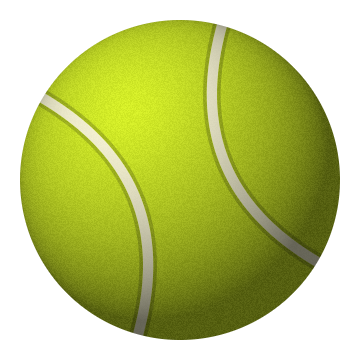

# Window Ball 🎾

[](https://github.com/marsik641/window-ball/actions/workflows/build.yml)
[](LICENSE)

<p align="center"></p>

Теннисный мяч поверх окон Windows. Схвати его мышью и брось: он вращается, падает, отскакивает от стен, потолка и пола, затем замирает.

## Запуск

Скачай переносимый архив из [Releases](https://github.com/marsik641/window-ball/releases), распакуй его и открой **WindowBall.exe** или **Запустить.cmd**. Установка и права администратора не нужны. Для переноса на другой компьютер достаточно `WindowBall.exe` и `WindowBall.exe.config`. Если релиз ещё не опубликован, программу можно собрать из исходников по инструкции ниже.

Поддерживается Windows 10/11 с .NET Framework 4.8 (установлен в современных Windows). Интернет для работы не нужен.

## Управление

| Действие | Управление |
| --- | --- |
| Взять и бросить | Зажать левую кнопку на мяче, потянуть и отпустить |
| Бросить сильнее | Резко двинуть мышью перед отпусканием |
| Просто положить | Остановить мышь перед отпусканием |
| Подбросить | Двойной щелчок |
| Настройки и выход | Правая кнопка по мячу или значку в трее |
| Вернуть потерявшийся мяч | Двойной щелчок по значку в трее |
| Перенести на другой монитор | Перетащить мяч мышью на нужный монитор |

В меню доступны три размера, три уровня упругости, пауза и отключение гравитации. По умолчанию мяч отскакивает от рабочей области монитора: пол находится над панелью задач. Выключи «Пол над панелью задач», чтобы использовать полные границы экрана. На другом мониторе физика продолжается после отпускания мяча. При отключении монитора мяч возвращается в видимую область.

Мяч не забирает фокус у рабочего окна. За прозрачными углами можно нажимать на другие приложения. Он находится поверх обычных окон; системные защищённые экраны и эксклюзивный полноэкранный режим управляются Windows.

В покое анимация приостанавливается. Звук, автозапуск и сетевые обращения отсутствуют. Размер, упругость и настройки сохраняются рядом с программой в `WindowBall.settings.json`; папка должна быть доступна для записи. При переносе этот файл можно взять с собой. Ошибки записываются рядом в `error.log`. Повторный запуск не создаёт второй мяч.

## Сборка

Без сторонних пакетов, SDK и скачиваний. Используется C# и компилятор .NET Framework из Windows:

```powershell
powershell -NoProfile -ExecutionPolicy Bypass -File .\build.ps1 -Test
```

Перед пересборкой закрой работающий мяч через меню. Скрипт собирает `WindowBall.exe` и при необходимости создаёт `ball.ico` из того же процедурного изображения.

В PowerShell 7 можно вызвать `./build.ps1 -Test -SmokeTest`: дополнительная проверка создаёт настоящее прозрачное окно на пару секунд. CI на Windows собирает программу, выполняет проверки физики и подготавливает архив в артефактах Actions.

Проверка настоящего прозрачного окна с таймером, броском, паузой и сменой размера:

```powershell
Start-Process .\WindowBall.exe -ArgumentList '--smoke-test smoke-results.txt' -Wait
Get-Content .\smoke-results.txt
```

Физика рассчитывается с фиксированным шагом 1/240 секунды, отрисовка идёт по таймеру примерно 60–120 раз в секунду в зависимости от планировщика Windows. Вращение использует 72 готовых кадра, а кадры передаются в небольшое [прозрачное окно Win32](https://learn.microsoft.com/en-us/windows/win32/api/winuser/nf-winuser-updatelayeredwindow). Скорость броска вычисляется по последним 100 мс движения, с ограничением экстремальных жестов. В покое таймер замедляется, перерисовка не выполняется.

Исходники: `Program.cs` — окно и управление, `BallPhysics.cs` — физика и броски, `BallArt.cs` — процедурная текстура, `Native.cs` — прозрачный слой и ресурсы Win32, `Settings.cs` — настройки, `SelfTests.cs` — проверки.

## Подготовка релиза

```powershell
powershell -NoProfile -ExecutionPolicy Bypass -File .\package-release.ps1
```

В `dist/v1.0.0/` появятся готовый ZIP, `SHA256SUMS.txt` и `RELEASE_NOTES.md`. В архив попадают только программа, конфигурация, инструкция, запускатель, лицензия и история изменений. Личные настройки, журналы и отчёты тестов не включаются.

Создание тега и релиза выполняется вручную на GitHub: выбери `main`, тег `v1.0.0`, вставь текст из `RELEASE_NOTES.md` и приложи ZIP и `SHA256SUMS.txt`. Скрипт и CI подготавливают файлы, не публикуя релиз.

Версия задаётся в `Properties/AssemblyInfo.cs`; перед новым выпуском обнови её, `CHANGELOG.md` и соответствующий файл в `docs/releases/`.

Лицензия: [MIT](LICENSE). Автор: [marsik641](https://github.com/marsik641).
