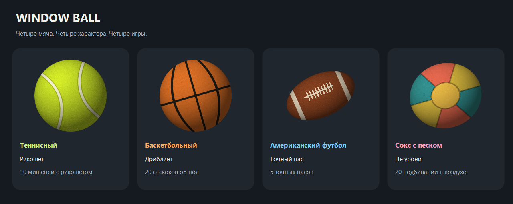

# Window Ball 🎾 🏀 🏈

[](https://github.com/marsik641/window-ball/actions/workflows/build.yml)
[](LICENSE)

<p align="center"></p>

Четыре мяча поверх окон Windows. Схвати мяч мышью и брось: он вращается, падает, отскакивает от стен, потолка и пола, затем замирает. Выбирай материал и запускай связанную с ним игру.

## Запуск

Скачай переносимый архив из [Releases](https://github.com/marsik641/window-ball/releases), распакуй его и открой **WindowBall.exe** или **Запустить.cmd**. Установка и права администратора не нужны. Для переноса на другой компьютер достаточно `WindowBall.exe` и `WindowBall.exe.config`. Если релиз ещё не опубликован, программу можно собрать из исходников по инструкции ниже.

Поддерживается Windows 10/11 с .NET Framework 4.8 (установлен в современных Windows). Интернет для работы не нужен.

## Управление

| Действие | Управление |
| --- | --- |
| Взять и бросить | Зажать левую кнопку на мяче, потянуть и отпустить |
| Бросить сильнее | Резко двинуть мышью перед отпусканием |
| Просто положить | Остановить мышь перед отпусканием |
| Подбросить | Двойной щелчок |
| Настройки и выход | Правая кнопка по мячу или значку в трее |
| Вернуть потерявшийся мяч | Двойной щелчок по значку в трее |
| Перенести на другой монитор | Перетащить мяч мышью на нужный монитор |

В меню доступны три размера, три уровня упругости, пауза и отключение гравитации. По умолчанию мяч отскакивает от рабочей области монитора: пол находится над панелью задач. Выключи «Пол над панелью задач», чтобы использовать полные границы экрана. На другом мониторе физика продолжается после отпускания мяча. При отключении монитора мяч возвращается в видимую область.

## Скины и игры

Правая кнопка → **Скин мяча**, затем **Начать игру**. В обычном режиме каждый скин можно свободно перетаскивать и бросать.

| Скин | Игра | Управление и цель |
| --- | --- | --- |
| Теннисный | Рикошет | За 60 секунд попасть в 10 мишеней. Перед попаданием нужен отскок от края экрана. Один бросок — одно попадание. |
| Баскетбольный | Дриблинг | Клик толкает мяч вниз с небольшим разбросом. Между каждым отскоком от пола нужен новый клик. Цель — серия из 20; пропущенный отскок завершает раунд. |
| Американский футбол | Точный пас | За 60 секунд сделать 5 прямых пасов из левой половины в движущуюся зону справа. Отскоки не засчитываются. После приёма мяч возвращается на подачу. |
| Сокс с песком | Не урони | Клик на падении подбрасывает сокс с небольшим разбросом. Цель — 20 подбиваний без касания пола. Клики при быстром подъёме не засчитываются. |

До первого действия мяч ждёт и таймер не идёт. В баскетболе и соксе игра управляется кликами; для перетаскивания вернись в **Обычный режим**. Пауза и открытое меню замораживают физику и время. Результат остаётся на экране до новой игры или возврата в обычный режим. Для каждого скина сохраняется свой рекорд.

HUD и мишени пропускают клики к приложениям под ними. При смене скина, переносе игры на другой монитор или изменении DPI раунд завершается и включается обычный режим. В игре гравитация и базовая упругость фиксированы.

У каждого материала свои масса, упругость, трение, воздушное сопротивление и затухание вращения. У футбольного мяча контакт зависит от ориентации вытянутого тела, у сокса удар почти неупругий. Расчёт, параметры и экранные допущения описаны в [физических моделях](docs/PHYSICS.md).

Мяч не забирает фокус у рабочего окна. За прозрачными углами можно нажимать на другие приложения. Он находится поверх обычных окон; системные защищённые экраны и эксклюзивный полноэкранный режим управляются Windows.

В покое анимация приостанавливается. Звук, автозапуск и сетевые обращения отсутствуют. Скин, рекорды, размер, упругость и настройки сохраняются рядом с программой в `WindowBall.settings.json`; папка должна быть доступна для записи. При переносе этот файл можно взять с собой. Ошибки записываются рядом в `error.log`. Повторный запуск не создаёт второй мяч.

## Сборка

Без сторонних пакетов, SDK и скачиваний. Используется C# и компилятор .NET Framework из Windows:

```powershell
powershell -NoProfile -ExecutionPolicy Bypass -File .\scripts\build.ps1 -Test
```

Перед пересборкой закрой работающий мяч через меню. Скрипт собирает `bin/WindowBall.exe`, копирует рядом конфигурацию и при необходимости создаёт `assets/ball.ico` из того же процедурного изображения. Для запуска из исходников открой `bin/WindowBall.exe`. Отчёты проверок находятся в `artifacts/`.

В PowerShell 7 можно вызвать `./scripts/build.ps1 -Test -SmokeTest`: дополнительная проверка создаёт настоящее прозрачное окно на несколько секунд. CI на Windows собирает программу, выполняет проверки физики и подготавливает архив в артефактах Actions. Скрипты определяют корень проекта по своему расположению и работают из любой текущей папки.

Проверка настоящего прозрачного окна с таймером, броском, паузой и сменой размера:

```powershell
Start-Process .\bin\WindowBall.exe -ArgumentList '--smoke-test artifacts/smoke-results.txt' -Wait
Get-Content .\artifacts\smoke-results.txt
```

Физика рассчитывается с фиксированным шагом 1/240 секунды, отрисовка идёт по таймеру примерно 60–120 раз в секунду в зависимости от планировщика Windows. Вращение использует 72 готовых кадра, а кадры передаются в небольшое [прозрачное окно Win32](https://learn.microsoft.com/en-us/windows/win32/api/winuser/nf-winuser-updatelayeredwindow). Скорость броска вычисляется по последним 100 мс движения, с ограничением экстремальных жестов. В покое таймер замедляется, перерисовка не выполняется.

## Структура репозитория

| Папка | Содержимое |
| --- | --- |
| [src](src/README.md) | Код приложения: управление, физика, игровые правила и графика |
| [tests](tests/README.md) | Проверки физики, игровых правил и настоящих окон |
| [scripts](scripts/README.md) | Сборка, запуск проверок и упаковка релиза |
| [packaging](packaging/README.md) | Манифест Windows, конфигурация и файлы переносимой программы |
| [assets](assets/README.md) | Иконка и изображения для документации |
| [docs](docs/README.md) | Описание физики, история изменений и тексты релизов |
| [bin](bin/README.md) | Готовая программа, её конфигурация и локальные настройки |
| [artifacts](artifacts/README.md) | Отчёты проверок и служебные изображения |
| [dist](dist/README.md) | ZIP-архивы, контрольные суммы и файлы для публикации релизов |
| [.github](.github/README.md) | Автоматическая сборка в GitHub Actions |

В каждой папке есть свой README. Содержимое `bin/`, `artifacts/` и `dist/` генерируется локально и не коммитится, кроме описаний папок.

## Подготовка релиза

```powershell
powershell -NoProfile -ExecutionPolicy Bypass -File .\scripts\package-release.ps1
```

В `dist/v1.1.0/` появятся готовый ZIP, `SHA256SUMS.txt` и `RELEASE_NOTES.md`. В архив попадают только программа, конфигурация, инструкция, запускатель, лицензия и история изменений. Личные настройки, журналы и отчёты тестов не включаются.

Создание тега и релиза выполняется вручную на GitHub: выбери `main`, тег `v1.1.0`, вставь текст из `RELEASE_NOTES.md` и приложи ZIP и `SHA256SUMS.txt`. Скрипт и CI подготавливают файлы, не публикуя релиз.

Версия задаётся в `src/Properties/AssemblyInfo.cs`; перед новым выпуском обнови её, `docs/CHANGELOG.md` и соответствующий файл в `docs/releases/`.

Лицензия: [MIT](LICENSE). Автор: [marsik641](https://github.com/marsik641).
